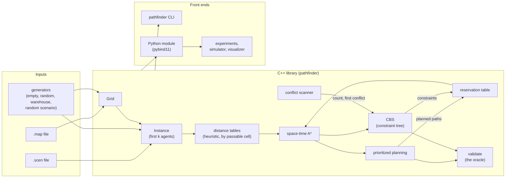

# Pathfinder: design

Pathfinder plans collision-free paths for many robots on a grid warehouse map at once (multi-agent path finding,
MAPF). It is the kind of planning a fleet of warehouse robots needs: every robot has a start and a goal, they all
move at the same time on the same grid, and no two may ever be in the same cell or swap cells in one step. This
document is the specification: what a valid plan is, which files it reads, and how the planners (days 2 and 3) and
the measurements (day 4) work. Where the code and this document disagree, one of them has a bug.

## The model

- **The grid.** A rectangle of cells, each passable or blocked, 1 to 10,000 on a side. A cell is written (x, y): x is
  the column (0 at the left) and y the row (0 at the top), as in the MovingAI files. In code a cell is a `CellId`,
  `y * width + x`. Cells outside the grid are blocked.
- **Time** is discrete: t = 0, 1, 2, ... Every agent acts at every step.
- **Actions.** In one step an agent either waits in its cell or moves to one of its four neighbours (north, east,
  south, west); the target must be passable. Every action costs 1, waiting included. No diagonal moves.
- **An instance** is a grid and k agents, each with a start and a goal cell. Starts are pairwise distinct, goals are
  pairwise distinct, and all are passable. (An agent's start may be another agent's goal.)
- **A path** for an agent is the list of its cells at t = 0, 1, ..., T. It begins at the agent's start, ends at its
  goal, and each consecutive pair is a wait or a move. **After its path ends, an agent stays at its goal for ever**
  (it doesn't disappear): later agents must route around it, and its own path can't end at the goal while another
  agent still has to pass through that cell.
- **A plan** is one path per agent. It is **valid** when every path is legal and no two agents conflict:
  - **vertex conflict**: agents a and b are in the same cell at the same time t (counting an agent that has finished
    as sitting on its goal);
  - **edge conflict** (swap): a moves u → v while b moves v → u between t and t + 1.

  Following is allowed (a moves into the cell b leaves in the same step), and so are rotations of three or more
  agents around a cycle; only head-on swaps are forbidden. This is the standard definition used by the MAPF benchmark
  suite (Stern et al., "Multi-Agent Pathfinding: Definitions, Variants, and Benchmarks", SoCS 2019).
- **Cost.** An agent's cost is the time it reaches its goal for the last time: the smallest t with the agent at its
  goal at every step from t on. Waits at the goal after that are free; waits anywhere else, or leaving the goal and
  coming back, are not. A plan's **sum of costs (SOC)** is the sum over agents; its **makespan** is the largest. The
  planners minimise SOC (CBS optimally, prioritized planning heuristically); makespan is reported alongside.

## Maps and scenarios: the MovingAI formats

Maps and scenarios come from the MovingAI benchmark sets (movingai.com/benchmarks/mapf), which every MAPF paper
uses, so results here can be compared with published ones. They aren't committed (they're not ours to redistribute):
`scripts/fetch_maps.py` downloads them, checks each archive's SHA-256 and unpacks them into `data/`. CI uses small
maps the generators below make, plus a few small hand-written files in `tests/data/`.

### Map files (`.map`)

```
type octile
height 4
width 6
map
......
.@@...
.@@.T.
......
```

- Header: `type`, `height` and `width`, each once, then the line `map`. `type` must be `octile` (the only type in
  the benchmark sets; it names the 8-connected movement of the original pathfinding benchmarks, but MAPF uses the
  maps 4-connected, and so does Pathfinder). Height and width are decimal integers 1..10,000, digits only.
- Then exactly `height` rows of exactly `width` characters. Passable: `.` (ground), `G` (ground) and `S` (swamp,
  "passable from regular terrain" in MovingAI's legend). Blocked: `@` and `O` (out of bounds), `T` (trees) and `W`
  (water, which MovingAI makes passable only from water; Pathfinder has no terrain modes, so it is blocked). Any
  other character is an error.
- Lines may end in `\n` or `\r\n` (and a `\r` ending the file's last line is dropped too). Header lines are fields
  separated by runs of spaces or tabs, so extra spaces around them, `map` included, don't matter. Blank lines after
  the last row are ignored; anything else after it is an error.
- Errors name the line number and say what was expected. Parsing never guesses: a short row, a missing header field
  or an unknown character is an error, not a padded or skipped row.
- Writing produces the canonical form (`\n` line ends, `.` for passable and `@` for blocked), and parsing that gives
  back the same grid.

### Scenario files (`.scen`)

```
version 1
0	maze-32-32-2.map	32	32	11	29	14	30	4
```

- The first line is `version 1` (or `version 1.0`). Each following non-blank line has nine fields separated by tabs
  or spaces: bucket, map file name, map width, map height, start x, start y, goal x, goal y, optimal length.
- Integers are decimal digits only; the optimal length is a plain decimal number (no sign or exponent).
  Coordinates must lie inside the stated width and height. The map name is one field: no spaces, tabs or other
  control characters (a `\r` inside a line is not a line end, so it would otherwise end up in the name).
- **The optimal length is the octile distance**, not the 4-connected one: the shortest path with 8-connected moves,
  diagonals costing √2 and never cutting a corner (a diagonal needs both cells it passes between to be free), rounded
  to 8 decimals. This holds for the MAPF scenarios too, although MAPF agents move 4-connected: in
  `empty-8-8-random-1.scen`, (1, 4) → (4, 7) is stated as 4.24264069 (3√2), where 4-connected moves need 6.
  `make check-maps` compares every entry of the 825 random scenarios with `octile_distance` (the same Dijkstra
  search as `octile_distances`, stopped once the goal is settled, so the same value to the last bit). Pathfinder doesn't
  plan with this column; its planners compute 4-connected distances themselves. (Day 1 first assumed the MAPF files
  stated 4-connected lengths; only 46,078 of their 690,275 entries do, and a corner-cutting octile rule matched 64 of
  272 sampled entries, against 272 of 272 without it.)
- **An instance with k agents is the scenario's first k entries**, as in the MAPF literature (the 825 random
  scenarios list 32 to 1,000 start-goal pairs each, 690,275 in all; papers report "the first k agents of scenario
  random-1").
- Building an instance checks the scenario against its map: the width and height match, every start and goal is
  passable, starts are distinct and goals are distinct. Whether each goal is reachable from its start is reported
  separately (an unreachable goal makes the instance unsolvable, which a planner must say, not loop on).

## Generated maps and scenarios

For CI and for experiments with controlled parameters, the library makes maps and scenarios itself, deterministically
from a seed: the same seed gives the same file on every platform and compiler (pinned by hashes in the tests).

- **Random numbers**: SplitMix64 with its own unbiased bounded draw (rejection of the biased low range), not
  `<random>`'s distributions, which differ between libstdc++ and libc++.
- **`empty(w, h)`**: every cell passable.
- **`random(w, h, obstacle percentage, seed)`**: exactly round(w · h · p / 100) blocked cells, chosen uniformly
  (a partial Fisher-Yates shuffle of the cells). The free cells may fall into several connected pieces; scenarios are
  drawn from the largest.
- **`warehouse(...)`**: rectangular shelf blocks in a regular array, separated by aisles, inside a free border. With
  `shelf_rows` × `shelf_columns` blocks of `shelf_width` × `shelf_height` cells, aisles `aisle` cells wide and a border
  `margin` cells wide, the map is `2·margin + shelf_columns·shelf_width + (shelf_columns − 1)·aisle` wide and
  `2·margin + shelf_rows·shelf_height + (shelf_rows − 1)·aisle` high. With aisle ≥ 1 and margin ≥ 1 every free cell
  is connected to every other (a test checks it). This is the layout of the MovingAI `warehouse-*` maps and of
  robotic fulfilment floors: narrow aisles where robots must queue or detour, and open space at the edges.
- **`random_scenario(grid, k, seed)`**: k agents with distinct starts and distinct goals in the grid's largest
  connected component, each agent's goal different from its own start, every such configuration equally likely
  (the goals are drawn again, all of them, whenever one lands on its agent's start). As in MovingAI's files, its
  optimal length column is the octile distance and its bucket that length divided by 4, rounded down, so a generated
  file means what a benchmark file means.

## Checking a plan

`validate(instance, plan)` is the oracle every planner is tested against; it shares no code with them beyond the grid.
It is deliberately simple (a per-time-step occupancy map, O(k · T) for k agents and makespan T) and reports
everything it finds, in a fixed order, rather than stopping at the first problem:

1. the plan has one path per agent (else nothing else is checked);
2. then each agent's own path, agent by agent: it isn't empty, it starts at the agent's start and ends at its goal,
   and, by time, every cell is inside the grid and passable and every step is a wait or a move to a 4-neighbour (so
   all of agent 0's problems come before any of agent 1's);
3. vertex conflicts, by time, with finished agents sitting on their goals until the last path ends;
4. edge (swap) conflicts, by time.

It also computes each path's cost, the SOC and the makespan, by the definitions above.

### Plan files (`.plan`)

MovingAI defines no format for solutions, so Pathfinder has its own, small and strict, for planners' output, the
CLI's `validate` and (day 5) the replay visualizer:

```
version 1
agents 3
0 (1,4) (2,4) (3,4)
1 (5,5) (5,5) (5,6)
2 (0,0)
```

- `version 1`, then `agents k` (k at most the grid's number of cells: no instance on it has more agents), then
  exactly k lines, the i-th beginning with the agent number i (in order, each
  once) followed by that agent's cells at t = 0, 1, ..., each written `(x,y)` with no spaces inside, separated by
  spaces or tabs. At least one cell per agent. Blank lines after the last agent are ignored; anything else is an
  error, and errors name their line, as for maps.
- Reading a plan needs its grid, to turn (x, y) into cell ids; a cell outside the grid is a parse error (as an id it
  would wrap onto another row). Whether the plan is *valid* is `validate`'s business, not the parser's: a plan file
  may hold an illegal or conflicting plan, so that the validator can say what's wrong with it.
- `pathfinder validate MAP SCEN PLAN` builds the instance of the scenario's first k entries (k from the plan) and
  prints the SOC and makespan of a valid plan, or the number of problems and the first 20 of them. It exits 0 for a
  valid plan; 1 for an invalid plan, or when those k entries don't make a valid instance; 2 when a file can't be
  read or parsed, or the plan has more agents than the scenario has entries.

## The planners (days 2 and 3)

All planners take an instance and limits (wall time, expanded nodes) and return a plan, or say why there is none:
an agent's goal is unreachable, the planner gave up within its limits, or (prioritized planning only) an agent
found no path around the ones planned before it.

- **Heuristic**: for each agent, the BFS distance to its goal from every cell, ignoring other agents. It is exact on
  the empty problem, so it is admissible and consistent for the space-time searches below.
  **Its budget, measured on day 1** (`make bench`, Apple M3, on battery): one BFS over a 1,024 x 1,024 map (20%
  blocked, synthetic) takes 8.5 ms and its table, 4 bytes per cell, 4.2 MB. A table per agent is cheap on warehouse
  maps (warehouse-20-40-10-2-2 has 55,760 cells: 223 KB an agent, 223 MB for 1,000) but not on the largest
  benchmark map (orz900d, 978,096 cells of which only 96,603 are passable: 3.9 GB for 1,000 agents).
  **Day 2's choice: tables by passable cell** (`heuristic.hpp`). A `PassableIndex` numbers a grid's passable cells
  once and lists each one's passable neighbours by number (4 bytes per cell plus 20 per passable cell, shared by
  every table of the grid); a `DistanceTable` holds 4 bytes per passable cell. On orz900d that is 386 KB a table
  instead of 3.9 MB (386 MB for 1,000 agents, plus a 5.8 MB index). A first version looked each neighbour's number
  up in the index during the BFS and was 12% to 31% *slower* to build than a table of every cell; with the
  neighbour lists the BFS never leaves passable numbers and is 1.2x to 2.3x *faster* (0.362 ms against 0.645 ms on
  orz900d, 0.076 ms against 0.139 ms on den520d; `make bench`, README "Results (day 2)"). A lookup during the
  search still costs one more memory read (cell → number) than a table of every cell. Prioritized planning builds
  each agent's table when its turn comes and drops it after (one table in memory at a time); CBS, which replans
  any agent at any node, will keep one per agent, which is where the tenfold saving matters.
- **The reservation table** (`reservation.hpp`) is written from the searching agent's side: every entry forbids that
  agent something. Three kinds: a cell at a time t; a move u → v between t and t + 1 (stored as a bit per direction
  under (u, t)); and a cell from a time on (another agent resting at its goal for ever). Prioritized planning turns
  each planned path into entries (`reserve_path`): its cell at every time before its last, the *reverse* of each of
  its moves (so the searching agent can't swap with it; following it stays allowed), and its last cell from its last
  time on. CBS's constraints (day 3) are the first two kinds directly. The table also keeps, per cell, the latest
  vertex entry (for the goal test) and the **horizon**: the latest time any entry concerns (t for a cell entry, t + 1
  for a move). Times are capped at 2^30, so every time the search computes from them fits 32 bits.
- **Space-time A\*** (day 2, `space_time_astar.hpp`): A\* over states (cell, t), whose successors are the five
  actions, with g = t (every action costs 1) and f = t + h(cell). Its goal test is "at the goal at a time after the
  last vertex entry on the goal", so a path never ends on a cell another agent must still cross; a goal someone
  rests on for ever, a goal in another piece and a start taken at t = 0 are refused before searching.
  **Termination, revised on day 2.** Day 1 planned an explicit bound (horizon + passable cells) on t. The search
  instead keys states by (cell, min(t, horizon + 1)): after the horizon nothing changes with time (no entry names a
  later time, and the cells forbidden for ever stay forbidden), so every later time of a cell is the same state. A
  late state reached again with a lower t is pushed again (A\*'s usual decrease-key; a test generator with walls the
  heuristic can't see makes this happen, and dropping the re-push gives arrivals two steps late). The state space
  is then finite, at most (horizon + 2) x passable cells, so the search ends by running out of states, and "no path"
  needs no bound at all. A brute-force oracle that does use day 1's bound (and looks twice as far when it finds
  nothing) agrees on 6,000 random problems (`tests/space_time_oracle_test.cpp`). Ties on f are broken towards larger
  t (deeper nodes), then by generation order, so runs are deterministic. Limits: expansions (optional: none means no
  limit, and 0 allows only a start that already passes the goal test), and a deadline checked every 1,024 expansions
  and before the first.
- **Prioritized planning** (day 2, the baseline, `planner.hpp`): agents in a fixed order (the scenario's order by
  default; the CLI also offers its reverse and distance-based orders) are planned one at a time with space-time A\*,
  each reserving its whole path, and its goal from its arrival on. Each agent's search gets the expansions the
  agents before it left, and the planner checks the clock before each agent as well (an agent on its goal needs no
  expansion, so the search alone would never look). Before any search, one `components()` pass
  reports an agent whose goal is in another piece (`kUnreachableGoal`: no planner could solve the instance). Fast,
  but neither complete (an early agent can wall in a later one: `kNoPath`, with the agent it stopped at) nor
  optimal. The two ways it fails in practice, both seen on day 2: a later agent starts on an earlier agent's goal
  and is boxed in before that agent arrives, and agents parked on their goals seal off the region a later agent's
  goal is in.
- **Conflict-based search, CBS** (day 3, Sharon et al., "Conflict-based search for optimal multi-agent pathfinding",
  AIJ 2015): a best-first search over a **constraint tree**. A node holds a set of constraints, one path per agent
  that satisfies its own agent's constraints (found by space-time A\* with the constraints as its table), and the SOC.
  The root has no constraints. The search pops the node of lowest SOC (ties: fewer conflicts, then creation order),
  finds one conflict in its plan, and splits it into two children, each forbidding the conflict to one of the two
  agents:
  - vertex conflict (a, b, v, t): child 1 forbids a from v at t, child 2 forbids b from v at t;
  - edge conflict (a, b, u → v, t): child 1 forbids a the move u → v at t, child 2 forbids b the move v → u at t.

  Only the constrained agent is replanned in each child. A node with no conflicts is a valid plan, and because every
  valid plan satisfies the constraints of at least one child at every split, the first one popped has minimum SOC.
  A vertex constraint on an agent's goal at time t means its path can't end there before t + 1, which is the goal
  test above. On an unsolvable instance whose goals are all reachable (two agents that must swap in a dead-end
  corridor) CBS can keep splitting for ever, so the node and time limits are part of its contract, not an
  afterthought.

  **As built (day 3, `src/cbs.cpp`).**
  - *A node stores only what it changed*: its parent, the one constraint it added, the agent it replanned and that
    agent's new path, its SOC and its conflict scan. Its other constraints and paths are its ancestors'. A node's plan
    is collected by walking up to the root, taking each agent's path from the nearest node that replanned it (else the
    root's); an agent's constraints, by the same walk. A `std::deque` holds the nodes, so a plan can be a list of
    pointers into it while the tree grows. The walk costs O(depth + k) per node, against copying k paths per node.
  - *Each agent's distance table is built once* for the run (one per agent, sharing a `PassableIndex`), since any node
    may replan any agent.
  - *The low level* is day 2's space-time A\* with a fresh reservation table of the agent's constraints: a vertex
    constraint is `forbid_vertex`, an edge constraint `forbid_move`. Nothing else was needed: the goal test already
    handles constraints on the goal, and the late-state merging already bounds the search.
  - *Conflicts* come from a `ConflictScanner` (`conflicts.hpp`): exactly the conflicts `validate()` reports, counted,
    and the earliest (a vertex conflict at t, then a swap between t and t + 1, then (a, b)). It keeps an epoch-stamped
    list per cell, sized once for the grid, instead of rebuilding a hash map at every time step: 23x to 34x faster
    than `validate()` on the same plans (README "Results (day 3)"). Each child's plan is scanned when it is made, so
    the open list can order by conflict count and the split needs no second scan.
  - *Limits*: `max_nodes` (nodes generated, the root included), `max_expansions` (all low-level searches together)
    and the time limit (checked before every low-level search and inside it). A child whose agent has no path under
    its constraints is dropped; if the open list empties, no plan exists (`kNoPath`). The swap corridor shows that
    this proof is rare: there each constraint only pushes a move later, so the tree never runs out.
  - *Checked against*: a brute-force optimum (Dijkstra's algorithm over joint states, from the model alone,
    `tests/cbs_oracle_test.cpp`): equal SOC on every one of 1,116 random tiny instances CBS finished, and never a plan
    where the brute force proves there is none.
- Later refinements, if time allows: choosing cardinal conflicts first, and a bypass. Each would be measured
  against plain CBS, not assumed to help. Day 3's measurements show where they would matter: on tiny dense
  instances CBS needs a median of 3 nodes but 18,894 at the 99th percentile, and ten agents on the warehouse floor
  take from 9 to 375,673 nodes depending on the seed.

## Python and the simulator (day 4)

A pybind11 module (`pathfinder._core`, re-exported by the `pathfinder` package) exposes the grid, the file formats,
the generators, the validator and the planners. Day 1's `examples/independent_paths.py` is the first script on it:
each agent's shortest path alone, and the conflicts that leaves. The experiments are Python scripts on top of it, and a step-by-step
simulator executes a plan one time step at a time, checking each step (so it can also replay a plan with a robot
delayed, to show what a plan's lack of slack costs).

## Measurements (day 4)

On generated warehouse and random maps and on MovingAI maps (with their own scenarios): success rate within a time
limit against the number of agents, runtime, and SOC of CBS against prioritized planning on the instances both
solve. Every number in the README comes with the command that produced it and the machine it ran on.

## Architecture



Days 2 to 5 fill in the planners, the simulator and the visualizer; day 1 builds the grid, the file formats, the
generators, the validator, the CLI and the Python module, so the planners have their inputs and their oracle from
the start.

## Testing

- Each format (map, scenario, plan) has hand-written good and bad inputs: every error names its line, and
  write-then-parse gives back the same grid, scenario or plan.
- The parsers take randomly damaged copies of valid files (20,000 of each kind, fixed seeds): the only exception is a
  `ParseError` naming a line in the file, and whatever is accepted writes back and reads back the same. This runs
  under ASan and UBSan too.
- Every MovingAI MAPF map and scenario parses, and each scenario is a valid instance of all its entries with every
  goal reachable (when `data/` has been fetched; CI skips that test and says so).
- The generators are pinned by hashes of their output, so a change in the random stream or the layout shows up as a
  failing test on every platform at once.
- The validator has a test for each rule, with a small plan that breaks only that rule, and one for each kind of
  plan it must accept (following, rotations, finishing early and waiting); its conflicts must equal those of a
  pairwise check of every two agents at every time on random-walk plans.
- Reviews (an agent in its own worktree) prove each finding with a failing test, kept in `tests/review/` and
  `tests/python/review/`; mutations of the code under test are re-run until each fails a test.
- From day 2: every planner's every plan goes through the validator. Space-time A\* is compared with a brute-force
  oracle (the set of cells the agent can be in at each time, from the reservation table's answers alone) on random
  problems from two generators: its arrival must be the earliest, and "no path" exactly when there is none. CBS's
  SOC (day 3) is compared with a brute-force search on tiny instances, and never above prioritized planning's; the
  conflict scanner is compared with `validate()` on random-walk plans. Every CBS call in a test has a node limit, so a
  broken CBS fails a test instead of hanging it.

## Day plan

| Day | Delivers |
|---|---|
| 1 | this document, the CMake and pybind11 scaffold, the grid, the MovingAI map and scenario formats, the generators, BFS, the validator, the CLI, the map fetch script, CI |
| 2 | space-time A\* with a reservation table, prioritized planning, heuristic tables by passable cell, `pathfinder plan`, the planner bindings, tests (a brute-force oracle for the search) |
| 3 | CBS, tests that no plan has a vertex or edge conflict, CBS against a brute-force optimum on tiny instances |
| 4 | benchmarks (success rate against agents, runtime, SOC against prioritized planning), the step-by-step simulator in Python |
| 5 | a replay visualizer, README results, WALKTHROUGH.md, v1.0.0 |
