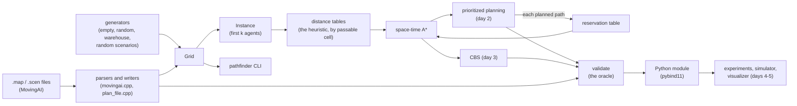

# Pathfinder

Collision-free paths for many robots on a grid warehouse map at once: multi-agent path finding (MAPF) by
conflict-based search, against prioritized planning as the baseline, in C++20 with Python bindings for experiments.

**Status: day 2 of 5.** Built so far: the specification ([DESIGN.md](DESIGN.md)), the grid, the MovingAI map and
scenario formats, a plan file format, seeded map and scenario generators (random and warehouse floors), BFS and
octile distances, the plan validator every planner is tested against, a CLI, the Python module, a script that
fetches the MovingAI MAPF benchmark set, and CI (day 1); then space-time A\* with a reservation table, checked against
a brute-force oracle, and prioritized planning, the baseline planner, in the library, the CLI (`pathfinder plan`)
and Python (day 2). Next: CBS (day 3), benchmarks and a step-by-step simulator (day 4), a replay visualizer and
v1.0.0 (day 5).

## Why

A warehouse full of robots is a shared grid where every robot needs its own path at the same time: two robots may
never be in the same cell at the same moment, or swap cells head-on in one step. Planning each robot alone and
hoping is how fleets deadlock in an aisle. MAPF plans them together. The two classic approaches trade off cleanly:

- **Prioritized planning** plans robots one at a time, each treating the earlier ones as moving obstacles. It is fast,
  but neither complete (an early robot can wall in a later one) nor optimal.
- **Conflict-based search (CBS)** plans each robot alone, finds the first collision, and branches on which of the two
  robots must avoid it. It returns a plan with the minimum sum of costs, at a cost that grows quickly with crowding.

Measuring where one stops being good enough and the other stops being fast enough is the point of day 4.

## The model in one paragraph

A 4-connected grid; discrete time; at each step every agent waits or moves to a passable neighbour. A plan is valid
when no two agents share a cell at the same time (an agent that has arrived stays on its goal) and no two swap cells
in one step; following and rotations are allowed. An agent's cost is the time of its final arrival at its goal; a
plan's sum of costs (SOC) adds them, its makespan is the largest. This is the standard definition of the MAPF
benchmark suite (Stern et al., SoCS 2019). [DESIGN.md](DESIGN.md) has the details and every rule the code enforces.

## Architecture



## Layout

| Path | What |
|---|---|
| `include/pathfinder/grid.hpp`, `src/grid.cpp` | the grid: cells, coordinates, neighbours in a fixed order |
| `include/pathfinder/movingai.hpp`, `src/movingai.cpp`, `src/text.hpp` | the `.map` and `.scen` formats: strict parsers with line-numbered errors, canonical writers |
| `include/pathfinder/instance.hpp`, `src/instance.cpp` | an instance (grid + agents), its rules, the first k entries of a scenario |
| `include/pathfinder/distance.hpp`, `src/distance.cpp` | BFS distances (the planners' heuristic), octile distances (to check scenario files), connected pieces |
| `include/pathfinder/rng.hpp`, `include/pathfinder/generate.hpp`, `src/generate.cpp` | SplitMix64 and the seeded generators |
| `include/pathfinder/plan.hpp`, `src/plan.cpp`, `src/plan_file.cpp` | paths, plans, costs, `validate`, and the `.plan` format |
| `include/pathfinder/heuristic.hpp`, `src/heuristic.cpp` | the planners' heuristic tables, by passable cell (`PassableIndex`, `DistanceTable`) |
| `include/pathfinder/reservation.hpp`, `src/reservation.cpp` | the reservation table: what a space-time search must avoid |
| `include/pathfinder/space_time_astar.hpp`, `src/space_time_astar.cpp` | space-time A\* |
| `include/pathfinder/planner.hpp`, `src/prioritized.cpp` | the planners' limits and result; prioritized planning |
| `tools/pathfinder_cli.cpp` | the `pathfinder` command |
| `python/` | the pybind11 module `pathfinder._core` and the `pathfinder` package |
| `tests/` | GoogleTest suites, `cli_test.sh`, `python/` (pytest), `data/` (small hand-written files), `review/` (the review's tests) |
| `scripts/` | `fetch_maps.py` (the benchmark set), `check_maps.sh`, `gcc_check.sh`, `pp_sweep.py` (prioritized planning on the benchmark maps) |
| `examples/` | `independent_paths.py`: each agent's shortest path alone, and the conflicts the validator finds |
| `bench/` | the Google Benchmark suite (`make bench`) |

## How to run

Needs CMake 3.25+, Ninja, a C++20 compiler (Apple Clang 21, GCC 14 and Clang 18 are the targets) and Python 3.11+.
CMake fetches GoogleTest 1.18.0 and pybind11 3.0.4 itself, as release tarballs pinned by SHA-256.

```bash
make check          # .venv with pytest, Debug build with warnings as errors, every test (GoogleTest, CLI, pytest)
make release        # the same on the optimised build
make asan           # the C++ tests under AddressSanitizer and UndefinedBehaviorSanitizer
make coverage       # line and branch coverage of the library by the C++ and CLI tests (Clang)
make gcc-check      # this project's files compiled with GCC (Homebrew's g++-15 here), warnings as errors
make maps           # download the MovingAI MAPF maps and random scenarios into data/ (checked by SHA-256)
make check-maps     # every benchmark scenario through `pathfinder check`
```

The CLI (`build/dev/pathfinder` after `make check`):

```bash
build/dev/pathfinder gen-map warehouse 3 4 5 2 1 2 > warehouse.map
build/dev/pathfinder info warehouse.map
build/dev/pathfinder gen-scen warehouse.map 20 7 > warehouse.scen
build/dev/pathfinder check warehouse.map warehouse.scen
build/dev/pathfinder validate tests/data/small.map tests/data/small.scen tests/data/small.plan
build/dev/pathfinder check data/mapf-map/random-32-32-20.map data/scen-random/random-32-32-20-random-1.scen 100
build/dev/pathfinder plan tests/data/small.map tests/data/small.scen 3 --out small.plan
build/dev/pathfinder plan data/mapf-map/empty-32-32.map data/scen-random/empty-32-32-random-1.scen 200 --order longest
```

`check` exits 0 when the instance is valid and every goal reachable, 1 when it isn't; `validate` exits 0 for a valid
plan (printing its SOC and makespan) and 1 for an invalid one (printing each problem); `plan` exits 0 when
prioritized planning solves the instance (printing the SOC next to its lower bound, the sum of the agents' distances
alone, and writing the plan to `--out` after `validate` has passed it) and 1 when it doesn't (printing which agent it
stopped at and why); all exit 2 on a usage error, a file that can't be read or parsed, or output that can't be
written. `plan` also takes `--order scenario|reverse|longest|shortest`, `--max-expansions N` and `--time-limit
SECONDS`. From Python:

```python
import pathfinder as pf                       # PYTHONPATH=build/dev/python
g = pf.warehouse_map(pf.WarehouseLayout())
s = pf.random_scenario(g, 20, seed=7, map_name="warehouse.map")
inst = pf.make_instance(g, s, 20)
check = pf.validate(inst, [[a.start] for a in inst.agents])   # paths of one cell each
print(check.valid, [pf.describe(p, g) for p in check.problems][:2])

r = pf.prioritized_planning(inst, time_limit=10.0)            # or order=[...], max_expansions=...
print(r.status, r.sum_of_costs, r.makespan, pf.validate(inst, r.plan).valid if r.solved else r.failed_agent)

table = pf.ReservationTable(g)                                # one agent around another's path
table.reserve_path(r.plan[0])
print(pf.space_time_astar(g, inst.agents[1].start, inst.agents[1].goal, table).path)
```

`examples/independent_paths.py` shows why a planner is needed: it gives each agent its own shortest path, ignoring
the others, and validates the result. With 40 agents on the default warehouse floor (204 free cells; seed 7) every
path is legal and shortest, so the sum of costs, 591, is the lower bound CBS starts from, and the plan has 83 vertex
and 23 swap conflicts (`PYTHONPATH=build/dev/python .venv/bin/python examples/independent_paths.py --agents 40
--seed 7`); with 150 agents (seed 3), 1,145 and 318. CTest runs it as `python.example`.

## Results (day 2)

Measured on an Apple M3, macOS 26.6.2, Apple Clang 21, on battery; every number comes from the command next to it.

- **Space-time A\* against brute force** (`tests/space_time_oracle_test.cpp`): 6,000 random problems from two
  generators agree on the earliest arrival and on "no path" (first generator: 1,768 found, 1,232 with no path, 650
  slowed by the reservations; second: 1,966, 1,034 and 427). Mutation checks (`.scratch`-only script, restored from a
  copy): dropping the move check, the wait's vertex check or the lower-time re-push of a late state each fail a test;
  the re-push survived the first generator for 300,000 rounds and fails the second in 60. Three survivors are
  equivalent mutants (DESIGN.md "The planners"; `b735e68`'s message says why for each).
- **Prioritized planning** (`tests/prioritized_test.cpp`): every solved plan on 150 random instances (up to a third
  of the free cells) is valid by `validate` with the SOC and makespan the planner reports, and never below the sum
  of the agents' distances; 108 are solved, and all 42 others are `kNoPath`, prioritized planning's incompleteness.
  On the default 27 x 12 warehouse floor (204 free cells) it solves seeds 1-3 at 10, 20 and 30 agents (SOC 4% to
  52% above the lower bound) and fails 2 of 3 at 40 and all 3 at 50 and 60; the 50-agent failure (seed 1, agent 27)
  is pinned by `FailsAtFiftyAgentsOnTheWarehouseFloor`. To reproduce:

  ```bash
  B=build/release/pathfinder; $B gen-map warehouse 3 4 5 2 1 2 > w.map
  for k in 10 20 30 40 50 60; do for s in 1 2 3; do $B gen-scen w.map $k $s > w.scen; $B plan w.map w.scen $k; done; done
  ```
- **What the search and the planner cost** (`make bench BENCH_ARGS="--benchmark_filter='OnMap|SpaceTime|Prioritized|DistanceTable|BM_Distances/'"`
  at `51b619e`, optimised build, medians of 5, CV at most 7.6% except prioritized planning at 50 agents, 13.8%):
  - One agent across a random 20%-blocked map (the same agent both ways): 4.57 µs (41 expansions) alone and 7.88 µs
    around 50 planned paths at 128 a side; 71.7 µs and 141 µs (576 expansions) at 512. With a table full of
    reservations an expansion costs about twice as much (hash lookups), 4.1 to 5.2 million expansions a second
    instead of 8.0 to 9.0 million.
  - Prioritized planning on a random 64 x 64 map (20% blocked, 3,277 free cells): 0.474 ms for 10 agents, 18.4 ms for
    50, 27.8 ms for 100.
  - **The heuristic tables, all cells against passable cells only** (one table, from the map's first passable cell;
    `make bench BENCH_ARGS="--benchmark_filter='OnMap|DistanceTable|BM_Distances/'"`, CV at most 4.5%). The first
    version of the passable-only table (at `51b619e`) looked up each neighbour's number during its BFS; the second
    (`PassableIndex::neighbors`) precomputes the neighbours by number:

    | Map | cells / passable | all cells: time, size | passable only, first: time | passable only, now: time, size (+ shared index) |
    |---|---|---|---|---|
    | den520d | 65,792 / 28,178 | 0.139 ms, 263 KB | 0.173 ms | 0.076 ms, 113 KB (+ 827 KB) |
    | warehouse-20-40-10-2-2 | 55,760 / 38,756 | 0.202 ms, 223 KB | 0.212 ms | 0.088 ms, 155 KB (+ 998 KB) |
    | orz900d | 978,096 / 96,603 | 0.645 ms, 3.91 MB | 0.713 ms | 0.362 ms, 386 KB (+ 5.84 MB) |
    | synthetic 1,024 x 1,024, 20% blocked | 1,048,576 / 838,861 | 8.73 ms, 4.19 MB | 11.3 ms | 7.46 ms, 3.36 MB |

    The first version cost 12% to 31% more time per table for a tenth of the memory on orz900d; with the neighbour
    lists the passable-only table is both smaller and 1.2x to 2.3x faster to build. (The all-cells column is from
    the second run; the first run's were within 3%: 0.138, 0.189, 0.638 and 8.63 ms.)

## Results (day 1)

Measured on an Apple M3, macOS 26.6.2, Apple Clang 21, on battery; every number comes from the command next to it.

- **Tests**: 100 CTest tests (`ctest --preset dev -N`): 88 GoogleTest tests, the reviews' 8, the CLI script (39
  commands with their exit codes and outputs), the review's CLI check, the pytest suite (25 tests, 9 of them from the
  reviews) and the example. A fresh clone at `e77c300` ran every CI step: 100 of 100 in Debug and in Release. `make check`
  passes, its tests in 8.6 s (CTest's "Total Test time"; most of it is the benchmark-set test). `make asan` passes
  (98 tests, 24.2 s, at `64eff8a`), and `make gcc-check` compiles every project file with g++-15, Debug and Release, warnings as errors. A
  fresh clone at `86ce608` ran every CI step (`make venv`, `make check`, `make release`, the benchmark smoke run):
  96 of 96 passed in Debug and in Release, the two benchmark-set tests skipping as they will in CI.
- **Coverage** (`make coverage`, at `4b3d411`): 761 of 765 lines (99.48%), 76 of 76 functions, 554 of 567 branches
  (97.71%) of the library (`src/`, `include/`) by the C++ tests and the CLI tests. The 4 lines left are defensive:
  `digits()` on an empty string (no caller passes one), an int64 overflow that 18 digits can't reach, a format
  failure the 512-byte buffer can't hit, and `describe`'s fallback for an unknown enum value.
- **The benchmark set** (`make maps`, then the tests and `make check-maps`): all 33 MAPF maps and 825 random
  scenarios parse, and every scenario is a valid instance of all its entries with every goal reachable: 690,275
  entries, 32 to 1,000 per file.
- **The scenarios' "optimal length" is the octile distance, not the 4-connected one.** I assumed MAPF scenarios
  would state 4-connected distances, since MAPF agents move 4-connected; only 46,078 of the 690,275 entries do (the
  first `pathfinder check`, at `466fcfa`, which compared with BFS, run over all 825 files: 94 s). A Python probe
  matched 272 of 272 sampled entries (the first 60, or all 32, of five maps' `random-1` scenarios) to the octile
  distance without corner cutting, and 64 of 272 with it. `make check-maps` (at `5ef5763`) then compared every
  entry: **690,275 of 690,275** equal the octile distance (to 1e-6), 0 files failing, 767 s on battery with a review
  agent and builds running; at `9a46eee`, with the single-pair search, again 690,275 of 690,275, in 398 s, alone. So `random_scenario` writes octile lengths too, and `check` reports octile matches; the planners use
  4-connected BFS distances, never this column.
- **The validator** agrees with a pairwise check of every two agents at every time step on 300 random-walk plans
  (`Validate.FindsTheSameConflictsAsAPairwiseCheckOnRandomWalks`), and with the review's independent Python model of
  DESIGN.md's rules on 20,000 random small instances (problems, order, costs, SOC and makespan; 0 mismatches). Nine
  mutations of it (six mine, three the review's survivors) each fail a test.
- **The parsers** take 20,000 randomly damaged maps and 20,000 damaged scenarios each without any exception but a
  `ParseError` naming a line in the file, and whatever they accept writes back and reads back the same
  (`ParserRobustness.*`, also under ASan); its first run found the `\r`-in-a-map-name bug below.
- **Determinism**: SplitMix64 matches the reference outputs for seed 1234567; four generated files are pinned by
  FNV-1a hash in both the C++ and the Python tests.
- **What the building blocks cost** (`make bench` at `4b3d411`, optimised build, medians of 5 repetitions, CV at most
  13%; on battery, load average 6.9 at the start; synthetic random maps with 20% obstacles):

  | Map side | BFS distances | octile distances | parse the `.map` |
  |---|---|---|---|
  | 32 | 4.30 µs | 21.4 µs | 1.90 µs |
  | 128 | 68.5 µs | 531 µs | 25.5 µs |
  | 512 | 1.93 ms | 14.3 ms | 647 µs |
  | 1,024 | 8.47 ms | 58.4 ms | 2.46 ms |

  `validate` checks about 21 million agent-steps a second (1,000 agents over 200 steps: 9.56 ms). One start-goal
  octile distance (64 random goals, `BM_OctilePair*` at `64eff8a`, CV at most 6.7%): 581 µs by the full search
  against 228 µs by the single-pair search that stops at the goal at 128 a side, 13.6 ms against 6.87 ms at 512. The planners' BFS
  table is 4 bytes per cell, which is what makes one table per agent fine on warehouse maps and 3.9 GB on orz900d
  with 1,000 agents (DESIGN.md "The planners").

- **CI** (GitHub Actions): green on all four jobs since `9f749fd` (run 42071924503: GCC 14 and Clang 18 on
  ubuntu-24.04, Apple Clang 17 on macos-15, 100 of 100 tests each in Debug and Release; ASan + UBSan, 98 of 98). The
  first run (42070958034, at `0a6e6fe`) was red on macOS only: Xcode 16's libc++ has no floating-point
  `std::from_chars`, which this Mac's Clang 21 has, so decimals are now parsed by one strict helper with a
  `strtod_l` fallback there (`9f749fd`).

## Review of day 1

The first review agent (at `5ef5763`, in its own worktree, worded as a correctness review) proved each finding with a failing
test; those tests are in `tests/review/` and `tests/python/review/`, and each fix came with its test:

1. `make_instance` trusted entry coordinates, and `grid.id()` wraps, so a code-built entry at (4, 0) on a 4x4 map
   became the cell (0, 1) (`0c6cdbf`).
2. Load errors named the line twice ("line 6: \<file\>: line 6: ..."); the tests matched a substring. I had found it
   minutes earlier while adding the plan format (`aac31ce`).
3. A failed read (a directory, an I/O error) looked like an early end of file, because an ifstream reports it that way
   (`856958b`, C stdio and `ferror`).
4. -0.0 was written as "-0", which the parser refuses; 5. lengths under about 1e-62 overflowed the writer's buffer;
   6. a zero-padded 19-character integer was refused (`897a504`).
7. `random_scenario`'s goal redraw made some configurations twice as likely as others (`be518b3`, rejection of the
   whole draw).
8. The CLI exited 0 when its output couldn't be written (`506ece9`).
9. Python could change a checked instance's grid through `Instance.grid`; 10. `Point(1, 2) == None` raised
   TypeError (`b81c8dc`).
11. `fetch_maps.py` flattened nested archive members, so two could overwrite each other (`9c307bb`).

It found no bug in `validate`; seven of its 14 mutants survived, and each now fails a test (`897a504`, `8b29b30`).

A second round (at `8b29b30`, asked what the first round's fixes broke; tests in `tests/review2/` and
`tests/python/review2/`) found two more: the new plan parser refused more than a million agents while `write_plan`
wrote them, so a valid plan couldn't be read back (`90a0305`: the bound is now the grid's cell count); and the new
duplicate check in `fetch_maps.py` compared names exactly on a file system (APFS) that ignores case and Unicode
normalisation (`66c25da`). Five of its eight mutants survived (the plan parser's parenthesis and bound checks, its
trailing-text loop, and `read_file` stopping after 64 KiB); each now fails a test (`90a0305`, `4b3d411`).

A third round (at `e77c300`, on the changes since the second; tests in `tests/python/review3/`) found three more, again
all in code written after the round before: the case-folding key still let 8 pairs of Greek spellings that APFS
stores as one file through (`fc4a207`, now Unicode's canonical caseless match); and the new any-size Python
coordinates refused `__index__` objects such as numpy's integers and turned an IndexError into a ValueError for ints
over 4,300 digits (`5e17d91`). It found `octile_distance` bit-identical to the full search on 82,134 pairs, and the
plan format and the example clean.
Found by my own tests: a `\r` inside a scenario line became part of a map name that the writer then refused
(`d9bcff4`, the robustness test's first run); `load_scenario`'s error path was untested (`07fbfab`, from the coverage
report); GCC 15 flagged a false maybe-uninitialized in the robustness test that Clang didn't, and the same test
chose between duplicating and dropping a line wrongly (`bdc43d0`).

## Design decisions

- **Strict parsers.** A short row, a duplicate header field or an unknown character is an error naming its line, never
  a padded or skipped row: a planner benchmarked on a silently mangled map produces numbers nobody can trust.
- **The validator is separate and simple.** It shares nothing with the planners beyond the grid, uses a per-time-step
  occupancy map, and reports everything in a fixed order. Planners get faster on later days; the oracle shouldn't
  change with them.
- **Finished agents stay on their goals.** That is the standard MAPF semantics and the one that makes warehouse sense
  (a robot doesn't vanish when it arrives), so the validator counts a parked agent in conflicts, and the planners'
  goal test (DESIGN.md) will forbid ending a path where another agent must still pass.
- **Generated files follow the benchmark's conventions**, octile lengths included, so a generated scenario means what
  a benchmark one means.
- **SplitMix64 instead of `<random>`'s distributions**, which differ between libstdc++ and libc++: the same seed gives
  the same map on Linux and macOS, which the pinned hashes check.
- **Cells as `y * width + x` integers** inside the library and in Python, with (x, y) only in files and messages: the
  searches index arrays by cell, and the boundaries (parsers, `make_instance`, the bindings) check coordinates,
  because an id wraps silently onto the next row.
- **The reservation table speaks for the searching agent** (day 2): every entry forbids it something (a cell at a
  time, a move at a time, a cell from a time on), so prioritized planning's reservations and CBS's constraints are the
  same data, and swaps are forbidden by reserving the *reverse* of each planned move.
- **Late states are merged instead of bounding time** (day 2): after the reservation table's horizon nothing changes
  with time, so the search keys states by (cell, min(t, horizon + 1)); it then ends by running out of states, and "no
  path" is a proof, not a timeout. A brute-force oracle that uses day 1's explicit bound agrees on 6,000 problems.
- **Heuristic tables by passable cell** (day 2): 4 bytes per passable cell instead of per cell, a tenth of the memory
  on orz900d, and (with the neighbours precomputed by passable number) faster to build too; chosen for CBS, which
  keeps a table per agent; prioritized planning holds one at a time.
- **Unsolvable instances are named up front**: a goal in another piece is `kUnreachableGoal` before any search, so a
  benchmark never spends its time limit proving it.
- **The benchmark set is fetched, not committed**, and checked by SHA-256 before anything is unpacked; the unpacker
  writes only `.map`/`.scen` files to plain paths under `data/`.

## Limitations

- Only the baseline planner so far: prioritized planning is neither complete nor optimal, and fails on crowded
  instances that have solutions (README "Results (day 2)"); CBS is day 3.
- A reservation table is hash sets: with 50 planned paths in it, each expansion costs about twice as much as with an
  empty table (`BM_SpaceTimeAStar`). Fine at day 2's sizes; a per-cell index would be the next step if it matters.
- The time limit is checked every 1,024 expansions, so a run can overshoot it by that much work.
- Movement is 4-connected only, with unit costs; MovingAI's terrain types other than passable/blocked (`S`, `W`) are
  folded into those two (the MAPF maps use only `.`, `@` and `T`).
- `random_scenario` and `pathfinder check` run one octile (Dijkstra) search per agent, stopped at its goal, which is
  still slow for many agents on the largest maps (orz900d, 1,491 x 656).

## Data and license

MIT ([LICENSE](LICENSE)). The benchmark maps and scenarios are from the MovingAI MAPF benchmarks
(movingai.com/benchmarks/mapf; Stern et al., "Multi-Agent Pathfinding: Definitions, Variants, and Benchmarks", SoCS
2019) and are downloaded by `scripts/fetch_maps.py`, not redistributed here.
