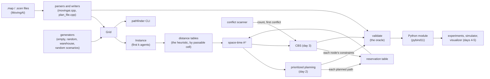

# Pathfinder

Collision-free paths for many robots on a grid warehouse map at once: multi-agent path finding (MAPF) by
conflict-based search, against prioritized planning as the baseline, in C++20 with Python bindings for experiments.

**Status: day 3 of 5.** Built so far: the specification ([DESIGN.md](DESIGN.md)), the grid, the MovingAI map and
scenario formats, a plan file format, seeded map and scenario generators (random and warehouse floors), BFS and
octile distances, the plan validator every planner is tested against, a CLI, the Python module, a script that
fetches the MovingAI MAPF benchmark set, and CI (day 1); then space-time A\* with a reservation table, checked against
a brute-force oracle, and prioritized planning, the baseline planner, in the library, the CLI (`pathfinder plan`)
and Python (day 2); then conflict-based search, which returns plans of minimum sum of costs, checked against a
brute-force optimum, with a fast conflict scanner, in the library, the CLI (`--planner cbs`) and Python (day 3).
Next: benchmarks and a step-by-step simulator (day 4), a replay visualizer and v1.0.0 (day 5).

## Why

A warehouse full of robots is a shared grid where every robot needs its own path at the same time: two robots may
never be in the same cell at the same moment, or swap cells head-on in one step. Planning each robot alone and
hoping is how fleets deadlock in an aisle. MAPF plans them together. The two classic approaches trade off cleanly:

- **Prioritized planning** plans robots one at a time, each treating the earlier ones as moving obstacles. It is fast,
  but neither complete (an early robot can wall in a later one) nor optimal.
- **Conflict-based search (CBS)** plans each robot alone, finds the first collision, and branches on which of the two
  robots must avoid it. It returns a plan with the minimum sum of costs, at a cost that grows quickly with crowding.

Measuring where one stops being good enough and the other stops being fast enough is the point of day 4.

## The model in one paragraph

A 4-connected grid; discrete time; at each step every agent waits or moves to a passable neighbour. A plan is valid
when no two agents share a cell at the same time (an agent that has arrived stays on its goal) and no two swap cells
in one step; following and rotations are allowed. An agent's cost is the time of its final arrival at its goal; a
plan's sum of costs (SOC) adds them, its makespan is the largest. This is the standard definition of the MAPF
benchmark suite (Stern et al., SoCS 2019). [DESIGN.md](DESIGN.md) has the details and every rule the code enforces.

## Architecture



## Layout

| Path | What |
|---|---|
| `include/pathfinder/grid.hpp`, `src/grid.cpp` | the grid: cells, coordinates, neighbours in a fixed order |
| `include/pathfinder/movingai.hpp`, `src/movingai.cpp`, `src/text.hpp` | the `.map` and `.scen` formats: strict parsers with line-numbered errors, canonical writers |
| `include/pathfinder/instance.hpp`, `src/instance.cpp` | an instance (grid + agents), its rules, the first k entries of a scenario |
| `include/pathfinder/distance.hpp`, `src/distance.cpp` | BFS distances (the planners' heuristic), octile distances (to check scenario files), connected pieces |
| `include/pathfinder/rng.hpp`, `include/pathfinder/generate.hpp`, `src/generate.cpp` | SplitMix64 and the seeded generators |
| `include/pathfinder/plan.hpp`, `src/plan.cpp`, `src/plan_file.cpp` | paths, plans, costs, `validate`, and the `.plan` format |
| `include/pathfinder/heuristic.hpp`, `src/heuristic.cpp` | the planners' heuristic tables, by passable cell (`PassableIndex`, `DistanceTable`) |
| `include/pathfinder/reservation.hpp`, `src/reservation.cpp` | the reservation table: what a space-time search must avoid |
| `include/pathfinder/space_time_astar.hpp`, `src/space_time_astar.cpp` | space-time A\* |
| `include/pathfinder/planner.hpp`, `src/planner_common.hpp`, `src/prioritized.cpp`, `src/cbs.cpp` | the planners' limits and result, what they check the same way; prioritized planning; CBS |
| `include/pathfinder/conflicts.hpp`, `src/conflicts.cpp` | the conflict scanner: a plan's conflicts, counted, and the earliest (what CBS splits on) |
| `tools/pathfinder_cli.cpp` | the `pathfinder` command |
| `python/` | the pybind11 module `pathfinder._core` and the `pathfinder` package |
| `tests/` | GoogleTest suites, `cli_test.sh`, `python/` (pytest), `data/` (small hand-written files), `review/` (the review's tests) |
| `scripts/` | `fetch_maps.py` (the benchmark set), `check_maps.sh`, `gcc_check.sh`, `pp_sweep.py` (prioritized planning on the benchmark maps) |
| `examples/` | `independent_paths.py`: each agent's shortest path alone, and the conflicts the validator finds; `prioritized_vs_independent.py`: the same floor planned both ways, and where prioritized planning stops |
| `bench/` | the Google Benchmark suite (`make bench`) |

## How to run

Needs CMake 3.25+, Ninja, a C++20 compiler (Apple Clang 21, GCC 14 and Clang 18 are the targets) and Python 3.11+.
CMake fetches GoogleTest 1.18.0 and pybind11 3.0.4 itself, as release tarballs pinned by SHA-256.

```bash
make check          # .venv with pytest, Debug build with warnings as errors, every test (GoogleTest, CLI, pytest)
make release        # the same on the optimised build
make asan           # the C++ tests under AddressSanitizer and UndefinedBehaviorSanitizer
make coverage       # line and branch coverage of the library by the C++ and CLI tests (Clang)
make gcc-check      # this project's files compiled with GCC (Homebrew's g++-15 here), warnings as errors
make maps           # download the MovingAI MAPF maps and random scenarios into data/ (checked by SHA-256)
make check-maps     # every benchmark scenario through `pathfinder check`
```

The CLI (`build/dev/pathfinder` after `make check`):

```bash
build/dev/pathfinder gen-map warehouse 3 4 5 2 1 2 > warehouse.map
build/dev/pathfinder info warehouse.map
build/dev/pathfinder gen-scen warehouse.map 20 7 > warehouse.scen
build/dev/pathfinder check warehouse.map warehouse.scen
build/dev/pathfinder validate tests/data/small.map tests/data/small.scen tests/data/small.plan
build/dev/pathfinder check data/mapf-map/random-32-32-20.map data/scen-random/random-32-32-20-random-1.scen 100
build/dev/pathfinder plan tests/data/small.map tests/data/small.scen 3 --out small.plan
build/dev/pathfinder plan data/mapf-map/empty-32-32.map data/scen-random/empty-32-32-random-1.scen 200 --order longest
build/dev/pathfinder plan data/mapf-map/random-32-32-20.map data/scen-random/random-32-32-20-random-1.scen 20 --planner cbs --time-limit 10
```

`check` exits 0 when the instance is valid and every goal reachable, 1 when it isn't; `validate` exits 0 for a valid
plan (printing its SOC and makespan) and 1 for an invalid one (printing each problem); `plan` exits 0 when
prioritized planning solves the instance (printing the SOC next to its lower bound, the sum of the agents' distances
alone, and writing the plan to `--out` after `validate` has passed it) and 1 when it doesn't (printing which agent it
stopped at and why); all exit 2 on a usage error, a file that can't be read or parsed, or output that can't be
written. `plan` also takes `--order scenario|reverse|longest|shortest`, `--max-expansions N` and `--time-limit
SECONDS`. With `--planner cbs` it runs CBS instead (and takes `--max-nodes N` to cap the constraint tree): the output
adds the nodes generated and expanded, a CBS that runs out of tree says no plan exists, and a limit names no agent.
From Python:

```python
import pathfinder as pf                       # PYTHONPATH=build/dev/python
g = pf.warehouse_map(pf.WarehouseLayout())
s = pf.random_scenario(g, 20, seed=7, map_name="warehouse.map")
inst = pf.make_instance(g, s, 20)
check = pf.validate(inst, [[a.start] for a in inst.agents])   # paths of one cell each
print(check.valid, [pf.describe(p, g) for p in check.problems][:2])

r = pf.prioritized_planning(inst, time_limit=10.0)            # or order=[...], max_expansions=...
print(r.status, r.sum_of_costs, r.makespan, pf.validate(inst, r.plan).valid if r.solved else r.failed_agent)

best = pf.cbs(inst, time_limit=10.0, max_nodes=100_000)       # minimum SOC, or LIMIT (as here: 20 agents on
                                                              # this floor take plain CBS over 100,000 nodes)
print(best.status, best.sum_of_costs, best.nodes_generated)
print(pf.scan_conflicts(g, [[a.start] for a in inst.agents]))  # (count, first Conflict or None)

table = pf.ReservationTable(g)                                # one agent around another's path
table.reserve_path(r.plan[0])
print(pf.space_time_astar(g, inst.agents[1].start, inst.agents[1].goal, table).path)
```

`examples/independent_paths.py` shows why a planner is needed: it gives each agent its own shortest path, ignoring
the others, and validates the result. With 40 agents on the default warehouse floor (204 free cells; seed 7) every
path is legal and shortest, so the sum of costs, 591, is the lower bound CBS starts from, and the plan has 83 vertex
and 23 swap conflicts (`PYTHONPATH=build/dev/python .venv/bin/python examples/independent_paths.py --agents 40
--seed 7`); with 150 agents (seed 3), 1,145 and 318. CTest runs it as `python.example`.

`examples/prioritized_vs_independent.py` plans one floor both ways. With 30 agents (seed 1): independent shortest
paths have a sum of costs of 435 (the lower bound) and 51 conflicts; prioritized planning's plan has none, at 550
(26% over the bound), makespan 34, 3,620 expansions; and taking the first k agents of one 102-agent scenario,
prioritized planning first fails at 43 agents, in either order (`PYTHONPATH=build/dev/python .venv/bin/python
examples/prioritized_vs_independent.py --agents 30 --seed 1`; CTest: `python.example.prioritized`).

## Results (day 3)

Measured on an Apple M3, macOS 26.6.2, Apple Clang 21, on battery, with a review agent building in its own worktree
(load 4 to 8): the timings carry that load; node, expansion and SOC counts don't depend on it. Every number comes from
the command next to it.

- **Tests**: 196 CTest tests at `d79e431` (`ctest --preset dev -N`; 170 on day 2): new are the conflict scanner's
  (`tests/conflicts_test.cpp`), CBS's (`tests/cbs_test.cpp`), the brute-force optimum (`tests/cbs_oracle_test.cpp`),
  the review's (`tests/review_d3/`), the late-goal search test, and CLI and pytest cases. `make asan` at `f4cc27a`:
  187 of 187. `make coverage` at `5a47089`: `src/cbs.cpp` 99.0% of lines, `src/conflicts.cpp` 94.5% (the epoch-wrap
  reset and the too-many-agents throw are the misses), the shared planner checks and prioritized planning 100%; all
  of the library 98.9% of lines and 97.3% of branches.
- **CBS is optimal where it can be checked.** `tests/cbs_oracle_test.cpp` compares it with a brute-force optimum
  (Dijkstra's algorithm over joint states of all the agents, written from the model alone) on 1,500 random tiny
  instances (2 x 2 to 4 x 4 grids, 2 to 4 agents): 1,148 solvable, and CBS's SOC equals the optimum on all 1,115 it
  finishes within 3,000 nodes; 226 unsolvable, and CBS never returns a plan for one (it never proves it either: the
  tree never runs out, so it stops at its limit). Prioritized planning is above the optimum on 113 of the solvable
  ones and fails on 241 (`build/dev/tests/pathfinder_tests --gtest_filter=CbsOracle.*`, at `766d3da`; before the
  goal bound: 1,116, 114 and 242).
- **Its effort is all over the place.** On those tiny instances it needs a median of 3 nodes, 35 at the 90th
  percentile and 849 at the 99th (the test's own output, 3,000-node limit). With the limit raised to 200,000 for one
  run (Release, 144 s, before the goal bound): median 3, 90th 60, 99th 18,894, the most for one it solved 184,035,
  and 8 solvable ones still unsolved. Ten agents on the default warehouse floor (`warehouse_map()`, seeds 1-5) take
  8,069 / 9 / 77 / 2,675 / 14,331 nodes for SOC 163 / 123 / 146 / 130 / 158, against prioritized planning's 178 /
  131 / 146 / 130 / 158 (Python, `pf.cbs(inst, max_nodes=2_000_000, time_limit=60)`, at most 100 ms). Before the
  goal bound seed 4 took 375,673 nodes and 3.16 s for the same SOC: which of several equally short paths the low
  level returns changes the whole tree. This is plain CBS's known weakness: many conflicts whose two children cost
  the same, so the open list fills with ties. Choosing cardinal conflicts first is the standard fix (DESIGN.md
  "Later refinements").
- **The goal bound in space-time A\*** (`766d3da`). On orz900d, CBS with 10 agents (scenario 2) built 2 tree nodes
  but made 36,416,522 low-level expansions and stopped at its 20 s limit (after 22.5 s). A constraint on an agent's
  goal far in the future, from another agent passing it late, forbids ending early; the heuristic didn't know, so
  the search tried every detour that ends too early. With f = max(t + h, the goal's last entry + 1) the same run
  takes 12 ms (3 nodes, 15,694 expansions, SOC 10,868, the lower bound), 20 agents on scenario 2 solve in 9.2 s,
  and a test's goal ten cells away taken at t = 500 costs 501 expansions instead of 1,408,200
  (`build/release/pathfinder plan data/mapf-map/orz900d.map data/scen-random/orz900d-random-2.scen 10 --planner cbs
  --time-limit 20`; `SpaceTimeAStar.ALateConstraintOnTheGoalDoesntMakeItSearchEveryDetour`).
- **On the MovingAI maps** (scenarios 1-5 of each, the first k agents, 10 s each; CLI loop below):

  | Map | Agents | Prioritized solved | CBS solved | Prioritized SOC over CBS's (both solved) | CBS time |
  |---|---|---|---|---|---|
  | random-32-32-20 | 10 | 5 / 5 | 5 / 5 | mean 3.8%, max 12.3% | under 1 ms |
  | random-32-32-20 | 20 | 5 / 5 | 5 / 5 | mean 6.3%, max 18.2% | 1-33 ms |
  | random-32-32-20 | 30 | 5 / 5 | 2 / 5 | mean 2.7%, max 4.3% | 1 ms, 0.98 s |
  | warehouse-10-20-10-2-1 | 10 | 5 / 5 | 5 / 5 | mean 4.5%, max 22.6% | 0-1 ms |
  | warehouse-10-20-10-2-1 | 20 | 5 / 5 | 5 / 5 | mean 3.2%, max 9.1% | 1-13 ms |
  | warehouse-10-20-10-2-1 | 30 | 5 / 5 | 3 / 5 | mean 3.2%, max 6.2% | 2-16 ms |

  CBS's SOC equals the lower bound (the agents' distances alone) on 17 of the 25 instances it solved; prioritized
  planning's on 7 of 30. Where CBS runs out of time at 30 agents it has generated 85,878 to 1,056,066 nodes. (These
  are at `766d3da`, with space-time A\*'s goal bound, above. Before it, the solved counts were the same but CBS took
  up to 176 ms at 20 agents and 1.5 s at 30, and prioritized planning's SOC came out slightly different, since the
  search now returns other equally short paths.)

  **The open list's tie-break pays.** Among nodes of equal SOC, CBS takes the one whose plan has fewer conflicts.
  Removing that rule (a temporary build, not committed: the comparison deleted from `Later` in `src/cbs.cpp`) changes
  no SOC, since both versions are optimal, but on the same 30 runs the 24 instances both solve take a median 1.65x
  as many nodes (8 unchanged, none fewer, the worst 186x: random-32-32-20 with 30 agents, scenario 3, 39 nodes
  against 7,271), and random-32-32-20 with 30 agents, scenario 5, no longer finishes within 10 s (111,481 nodes and
  0.98 s with it). Measured at `766d3da` (`.scratch/rerun_d3.sh`, not committed); before the goal bound the figures
  were the same but 1.66x.

  ```bash
  for map in random-32-32-20 warehouse-10-20-10-2-1; do for k in 10 20 30; do for s in 1 2 3 4 5; do
    build/release/pathfinder plan data/mapf-map/$map.map data/scen-random/$map-random-$s.scen $k --time-limit 10
    build/release/pathfinder plan data/mapf-map/$map.map data/scen-random/$map-random-$s.scen $k --planner cbs --time-limit 10
  done; done; done
  ```
- **The conflict scanner** (`make bench BENCH_ARGS="'--benchmark_filter=Validate|ConflictScan|Cbs|PrioritizedPlanning'"`,
  medians of 5): on the same plans (k agents waiting 200 steps), `validate()` takes 95.3 µs / 920 µs / 9.46 ms at
  10 / 100 / 1,000 agents (about 21M agent-steps/s) and the scanner 2.84 µs / 32.1 µs / 416 µs (705M / 625M / 485M):
  34x, 29x and 23x faster. CV under 2.3% except the scanner at 1,000 agents (10.4%).
- **CBS on a 64 x 64 random map** (20% obstacles, the scenario prioritized planning's benchmark uses; `make bench
  BENCH_ARGS="'--benchmark_filter=Cbs|PrioritizedPlanning'"`, medians of 5, at `766d3da`): 0.321 ms (1 node, SOC
  495) / 1.06 ms (17 nodes, 2,318 expansions, SOC 1,019) / 2.47 ms (69 nodes, 5,879 expansions, SOC 1,265) at 10 /
  20 / 30 agents. Before the goal bound (at `3337cfe`): 0.265 / 5.94 / 11.9 ms with the same trees but 30,222 and
  72,087 expansions. At 40 and 50 agents CBS doesn't finish within 500,000 nodes, before or after the goal bound
  (Python probe, `pf.cbs(inst, max_nodes=500_000, time_limit=20)`: 59.9M and 26.9M expansions, 19.6 s and 12.4 s at
  load 5; before it 60.5M and 26.9M, 13.6 s and 9.1 s).
- **The goal bound helps prioritized planning too**: the same benchmark's prioritized planning of 50 and 100 agents
  went from 14.9 and 23.0 ms (at `3337cfe`, matching day 2's 14.4-14.9 ms) to 3.58 and 6.68 ms, with SOC 2,272 and
  4,372 instead of 2,257 and 4,334 (other equally short paths change who is reserved where). The CVs of that run were
  high at 10 and 50 agents (25% and 21%, load 5 to 8), so take the 4x as approximate.

## Results (day 2)

Measured on an Apple M3, macOS 26.6.2, Apple Clang 21, on battery; every number comes from the command next to it.

- **Tests**: 170 CTest tests at the end of day 2 (`ctest --preset dev -N`; 100 on day 1): the main GoogleTest suite
  has 140 (88 on day 1), the three day-2 reviews' 7 + 5 + 4 (and a CLI script), the pytest suite 46 tests (25), the
  main CLI script 59 `expect` lines (39), and two examples. `make check` passes, and `make gcc-check` compiles every project
  file with g++-15 in Debug and Release. `make asan` at `f6849f8`: 156 of 156. `make coverage` at `f6849f8`: the four
  new source files are covered but for two lines (a check for a path of more than 2^30 steps, and an accessor only
  the Python module calls); the library as a whole 1,403 lines at 99.14%, branches 97.25%.
- **Space-time A\* against brute force** (`tests/space_time_oracle_test.cpp`): 6,000 random problems from two
  generators agree on the earliest arrival and on "no path" (first generator: 1,768 found, 1,232 with no path, 650
  slowed by the reservations; second: 1,966, 1,034 and 427). Mutation checks (`.scratch`-only script, restored from a
  copy): dropping the move check, the wait's vertex check or the lower-time re-push of a late state each fail a test;
  the re-push survived the first generator for 300,000 rounds and fails the second in 60. Three survivors are
  equivalent mutants (DESIGN.md "The planners"; `b735e68`'s message says why for each).
- **Prioritized planning** (`tests/prioritized_test.cpp`): every solved plan on 150 random instances (up to a third
  of the free cells) is valid by `validate` with the SOC and makespan the planner reports, and never below the sum
  of the agents' distances; 108 are solved, and all 42 others are `kNoPath`, prioritized planning's incompleteness.
  On the default 27 x 12 warehouse floor (204 free cells) it solves seeds 1-3 at 10, 20 and 30 agents (SOC 4% to
  52% above the lower bound) and fails 2 of 3 at 40 and all 3 at 50 and 60; the 50-agent failure (seed 1, agent 27)
  is pinned by `FailsAtFiftyAgentsOnTheWarehouseFloor`. To reproduce:

  ```bash
  B=build/release/pathfinder; $B gen-map warehouse 3 4 5 2 1 2 > w.map
  for k in 10 20 30 40 50 60; do for s in 1 2 3; do $B gen-scen w.map $k $s > w.scen; $B plan w.map w.scen $k; done; done
  ```
- **Prioritized planning on the MovingAI benchmark maps** (`PYTHONPATH=build/release/python .venv/bin/python
  scripts/pp_sweep.py --maps empty-32-32 random-32-32-20 room-64-64-8 warehouse-10-20-10-2-1 den520d --agents 50 100
  200 300 400 --scenarios 1-10 --time-limit 30` at `4db3e63`, optimised build, load average 5.7 at the start; the
  first k agents of each map's random scenarios 1-10; "solved" counts tries that returned a plan, every one checked
  by `validate`; the ratio is the mean over solved tries of the SOC over the sum of the agents' distances alone):

  | map | agents | solved | median time | max time | SOC / lower bound |
  |---|---:|---:|---:|---:|---:|
  | empty-32-32 | 50 | 10 / 10 | 4.2 ms | 10.8 ms | 1.065 |
  | empty-32-32 | 100 | 10 / 10 | 13.2 ms | 26.8 ms | 1.141 |
  | empty-32-32 | 200 | 9 / 10 | 48.5 ms | 70.9 ms | 1.252 |
  | empty-32-32 | 300 | 2 / 10 | 73.5 ms | 113.5 ms | 1.345 |
  | empty-32-32 | 400 | 0 / 10 | 74.1 ms | 135.6 ms | - |
  | random-32-32-20 | 50 | 9 / 10 | 3.4 ms | 7.4 ms | 1.106 |
  | random-32-32-20 | 100 | 7 / 10 | 11.8 ms | 15.6 ms | 1.201 |
  | random-32-32-20 | 200 | 0 / 10 | 18.2 ms | 57.9 ms | - |
  | random-32-32-20 | 300 | 0 / 10 | 18.0 ms | 120.8 ms | - |
  | random-32-32-20 | 400 | 0 / 10 | 17.9 ms | 59.4 ms | - |
  | room-64-64-8 | 50 | 9 / 10 | 21.2 ms | 61.7 ms | 1.082 |
  | room-64-64-8 | 100 | 5 / 10 | 84.1 ms | 125.1 ms | 1.162 |
  | room-64-64-8 | 200 | 0 / 10 | 127.6 ms | 438.0 ms | - |
  | room-64-64-8 | 300 | 0 / 10 | 128.1 ms | 437.7 ms | - |
  | room-64-64-8 | 400 | 0 / 10 | 127.1 ms | 437.5 ms | - |
  | warehouse-10-20-10-2-1 | 50 | 10 / 10 | 50.1 ms | 90.3 ms | 1.048 |
  | warehouse-10-20-10-2-1 | 100 | 10 / 10 | 161.1 ms | 306.3 ms | 1.084 |
  | warehouse-10-20-10-2-1 | 200 | 7 / 10 | 735.5 ms | 880.3 ms | 1.172 |
  | warehouse-10-20-10-2-1 | 300 | 4 / 10 | 1260.1 ms | 1817.4 ms | 1.235 |
  | warehouse-10-20-10-2-1 | 400 | 1 / 10 | 1469.5 ms | 3090.8 ms | 1.291 |
  | den520d | 50 | 10 / 10 | 205.4 ms | 800.6 ms | 1.021 |
  | den520d | 100 | 10 / 10 | 533.8 ms | 1388.0 ms | 1.029 |
  | den520d | 200 | 10 / 10 | 2901.3 ms | 5529.6 ms | 1.053 |
  | den520d | 300 | 10 / 10 | 6310.2 ms | 10728.6 ms | 1.068 |
  | den520d | 400 | 10 / 10 | 10810.1 ms | 14002.2 ms | 1.080 |

  It fails fast and cleanly (`kNoPath` in tens of milliseconds on the small maps) and its plans are close to the
  lower bound where it succeeds (2% to 35% above it), but its success rate collapses with crowding: none of 10 at
  200 agents on random-32-32-20 (819 free cells) or room-64-64-8, while den520d (28,178 free cells) still solves all
  10 at 400 agents, in 10.8 s at the median. No time limit was hit. This is the baseline CBS (day 3) is measured
  against on day 4.
- **The order matters as much as the planner** (`pathfinder plan ... --order`, at `0108b4d`, optimised build, load
  average about 10, so the times are high; expansions don't depend on load). On den520d, scenario 1, 400 agents:

  | order | SOC (lower bound 68,028) | expansions | time |
  |---|---:|---:|---:|
  | scenario | 72,642 | 20,751,299 | 8,114 ms |
  | shortest first | 68,414 | 424,764 | 195 ms |
  | longest first | 76,445 | 39,176,749 | 15,278 ms |

  Shortest-first is 49x fewer expansions and 0.6% above the bound: agents with short paths arrive and park early,
  so the reservation horizons later agents search against stay short. But on crowded maps it solves *fewer*
  instances, and longest-first solves the most (solved of scenarios 1-10):

  | map, agents | scenario | shortest first | longest first |
  |---|---:|---:|---:|
  | random-32-32-20, 100 | 7 | 3 | 9 |
  | random-32-32-20, 200 | 0 | 0 | 1 |
  | room-64-64-8, 100 | 5 | 3 | 10 |
  | room-64-64-8, 200 | 0 | 0 | 7 |
  | empty-32-32, 100 | 10 | 10 | 10 |
  | empty-32-32, 200 | 9 | 8 | 9 |

  (`for o in scenario shortest longest; do for n in $(seq 10); do build/release/pathfinder plan
  data/mapf-map/MAP.map data/scen-random/MAP-random-$n.scen K --order $o; done; done`; `scripts/pp_sweep.py --maps
  random-32-32-20 room-64-64-8 empty-32-32 --agents 100 200 --scenarios 1-10 --orders scenario shortest longest`
  gives the same counts (the script as committed in `9b58cd9`; the library is unchanged since `0108b4d`).) Long-path agents planned first get the open floor before short-path agents
  park in their way; planned last, they find it blocked. Where all orders succeed, shortest-first plans are the
  closest to the bound (empty-32-32, 100 agents: SOC 1.010 x the bound against 1.141 for the scenario order and
  1.254 for longest-first; 200 agents: 1.033, 1.252, 1.376). So there is no best order, which is one argument for
  CBS.
- **What the search and the planner cost** (`make bench BENCH_ARGS="--benchmark_filter='OnMap|SpaceTime|Prioritized|DistanceTable|BM_Distances/'"`
  at `51b619e`, optimised build, medians of 5, CV at most 7.6% except prioritized planning at 50 agents, 13.8%):
  - One agent across a random 20%-blocked map (the same agent both ways): 4.57 µs (41 expansions) alone and 7.88 µs
    around 50 planned paths at 128 a side; 71.7 µs and 141 µs (576 expansions) at 512. With a table full of
    reservations an expansion costs about twice as much (hash lookups), 4.1 to 5.2 million expansions a second
    instead of 8.0 to 9.0 million.
  - Prioritized planning on a random 64 x 64 map (20% blocked, 3,277 free cells): 0.474 ms for 10 agents, 18.4 ms for
    50, 27.8 ms for 100.
  - **The heuristic tables, all cells against passable cells only** (one table, from the map's first passable cell;
    `make bench BENCH_ARGS="--benchmark_filter='OnMap|DistanceTable|BM_Distances/'"`, CV at most 4.5%). The first
    version of the passable-only table (at `51b619e`) looked up each neighbour's number during its BFS; the second
    (`PassableIndex::neighbors`) precomputes the neighbours by number:

    | Map | cells / passable | all cells: time, size | passable only, first: time | passable only, now: time, size (+ shared index) |
    |---|---|---|---|---|
    | den520d | 65,792 / 28,178 | 0.139 ms, 263 KB | 0.173 ms | 0.076 ms, 113 KB (+ 827 KB) |
    | warehouse-20-40-10-2-2 | 55,760 / 38,756 | 0.202 ms, 223 KB | 0.212 ms | 0.088 ms, 155 KB (+ 998 KB) |
    | orz900d | 978,096 / 96,603 | 0.645 ms, 3.91 MB | 0.713 ms | 0.362 ms, 386 KB (+ 5.84 MB) |
    | synthetic 1,024 x 1,024, 20% blocked | 1,048,576 / 838,861 | 8.73 ms, 4.19 MB | 11.3 ms | 7.46 ms, 3.36 MB |

    The first version cost 12% to 31% more time per table for a tenth of the memory on orz900d; with the neighbour
    lists the passable-only table is both smaller and 1.2x to 2.3x faster to build. (The all-cells column is from
    the second run; the first run's were within 7%: 0.138, 0.189, 0.638 and 8.63 ms.) Checking that the index is
    the grid's (`PassableIndex::fits`, after the review) costs little: 0.077, 0.096 and 0.358 ms at `4db3e63`.
  - **A byte per cell in the reservation table** (`66cde20`) lets the search skip the hash tables for cells nothing
    names. An interleaved A/B of the two benchmark binaries (three rounds of three repetitions, load average 5 to
    11): prioritized planning of 50 agents 18.0-19.0 ms → 14.4-14.9 ms, of 100 agents 25.6-27.0 → 22.5-23.6 ms;
    one agent around 50 planned paths on a 512 map 142-176 → 114-128 µs, and no change on a 128 map, where most
    cells near the path are named.

## Results (day 1)

Measured on an Apple M3, macOS 26.6.2, Apple Clang 21, on battery; every number comes from the command next to it.

- **Tests**: 100 CTest tests (`ctest --preset dev -N`): 88 GoogleTest tests, the reviews' 8, the CLI script (39
  commands with their exit codes and outputs), the review's CLI check, the pytest suite (25 tests, 9 of them from the
  reviews) and the example. A fresh clone at `e77c300` ran every CI step: 100 of 100 in Debug and in Release. `make check`
  passes, its tests in 8.6 s (CTest's "Total Test time"; most of it is the benchmark-set test). `make asan` passes
  (98 tests, 24.2 s, at `64eff8a`), and `make gcc-check` compiles every project file with g++-15, Debug and Release, warnings as errors. A
  fresh clone at `86ce608` ran every CI step (`make venv`, `make check`, `make release`, the benchmark smoke run):
  96 of 96 passed in Debug and in Release, the two benchmark-set tests skipping as they will in CI.
- **Coverage** (`make coverage`, at `4b3d411`): 761 of 765 lines (99.48%), 76 of 76 functions, 554 of 567 branches
  (97.71%) of the library (`src/`, `include/`) by the C++ tests and the CLI tests. The 4 lines left are defensive:
  `digits()` on an empty string (no caller passes one), an int64 overflow that 18 digits can't reach, a format
  failure the 512-byte buffer can't hit, and `describe`'s fallback for an unknown enum value.
- **The benchmark set** (`make maps`, then the tests and `make check-maps`): all 33 MAPF maps and 825 random
  scenarios parse, and every scenario is a valid instance of all its entries with every goal reachable: 690,275
  entries, 32 to 1,000 per file.
- **The scenarios' "optimal length" is the octile distance, not the 4-connected one.** I assumed MAPF scenarios
  would state 4-connected distances, since MAPF agents move 4-connected; only 46,078 of the 690,275 entries do (the
  first `pathfinder check`, at `466fcfa`, which compared with BFS, run over all 825 files: 94 s). A Python probe
  matched 272 of 272 sampled entries (the first 60, or all 32, of five maps' `random-1` scenarios) to the octile
  distance without corner cutting, and 64 of 272 with it. `make check-maps` (at `5ef5763`) then compared every
  entry: **690,275 of 690,275** equal the octile distance (to 1e-6), 0 files failing, 767 s on battery with a review
  agent and builds running; at `9a46eee`, with the single-pair search, again 690,275 of 690,275, in 398 s, alone. So `random_scenario` writes octile lengths too, and `check` reports octile matches; the planners use
  4-connected BFS distances, never this column.
- **The validator** agrees with a pairwise check of every two agents at every time step on 300 random-walk plans
  (`Validate.FindsTheSameConflictsAsAPairwiseCheckOnRandomWalks`), and with the review's independent Python model of
  DESIGN.md's rules on 20,000 random small instances (problems, order, costs, SOC and makespan; 0 mismatches). Nine
  mutations of it (six mine, three the review's survivors) each fail a test.
- **The parsers** take 20,000 randomly damaged maps and 20,000 damaged scenarios each without any exception but a
  `ParseError` naming a line in the file, and whatever they accept writes back and reads back the same
  (`ParserRobustness.*`, also under ASan); its first run found the `\r`-in-a-map-name bug below.
- **Determinism**: SplitMix64 matches the reference outputs for seed 1234567; four generated files are pinned by
  FNV-1a hash in both the C++ and the Python tests.
- **What the building blocks cost** (`make bench` at `4b3d411`, optimised build, medians of 5 repetitions, CV at most
  13%; on battery, load average 6.9 at the start; synthetic random maps with 20% obstacles):

  | Map side | BFS distances | octile distances | parse the `.map` |
  |---|---|---|---|
  | 32 | 4.30 µs | 21.4 µs | 1.90 µs |
  | 128 | 68.5 µs | 531 µs | 25.5 µs |
  | 512 | 1.93 ms | 14.3 ms | 647 µs |
  | 1,024 | 8.47 ms | 58.4 ms | 2.46 ms |

  `validate` checks about 21 million agent-steps a second (1,000 agents over 200 steps: 9.56 ms). One start-goal
  octile distance (64 random goals, `BM_OctilePair*` at `64eff8a`, CV at most 6.7%): 581 µs by the full search
  against 228 µs by the single-pair search that stops at the goal at 128 a side, 13.6 ms against 6.87 ms at 512. The planners' BFS
  table is 4 bytes per cell, which is what makes one table per agent fine on warehouse maps and 3.9 GB on orz900d
  with 1,000 agents (DESIGN.md "The planners").

- **CI** (GitHub Actions): green on all four jobs since `9f749fd` (run 42071924503: GCC 14 and Clang 18 on
  ubuntu-24.04, Apple Clang 17 on macos-15, 100 of 100 tests each in Debug and Release; ASan + UBSan, 98 of 98). The
  first run (42070958034, at `0a6e6fe`) was red on macOS only: Xcode 16's libc++ has no floating-point
  `std::from_chars`, which this Mac's Clang 21 has, so decimals are now parsed by one strict helper with a
  `strtod_l` fallback there (`9f749fd`).

## Review of day 1

The first review agent (at `5ef5763`, in its own worktree, worded as a correctness review) proved each finding with a failing
test; those tests are in `tests/review/` and `tests/python/review/`, and each fix came with its test:

1. `make_instance` trusted entry coordinates, and `grid.id()` wraps, so a code-built entry at (4, 0) on a 4x4 map
   became the cell (0, 1) (`0c6cdbf`).
2. Load errors named the line twice ("line 6: \<file\>: line 6: ..."); the tests matched a substring. I had found it
   minutes earlier while adding the plan format (`aac31ce`).
3. A failed read (a directory, an I/O error) looked like an early end of file, because an ifstream reports it that way
   (`856958b`, C stdio and `ferror`).
4. -0.0 was written as "-0", which the parser refuses; 5. lengths under about 1e-62 overflowed the writer's buffer;
   6. a zero-padded 19-character integer was refused (`897a504`).
7. `random_scenario`'s goal redraw made some configurations twice as likely as others (`be518b3`, rejection of the
   whole draw).
8. The CLI exited 0 when its output couldn't be written (`506ece9`).
9. Python could change a checked instance's grid through `Instance.grid`; 10. `Point(1, 2) == None` raised
   TypeError (`b81c8dc`).
11. `fetch_maps.py` flattened nested archive members, so two could overwrite each other (`9c307bb`).

It found no bug in `validate`; seven of its 14 mutants survived, and each now fails a test (`897a504`, `8b29b30`).

A second round (at `8b29b30`, asked what the first round's fixes broke; tests in `tests/review2/` and
`tests/python/review2/`) found two more: the new plan parser refused more than a million agents while `write_plan`
wrote them, so a valid plan couldn't be read back (`90a0305`: the bound is now the grid's cell count); and the new
duplicate check in `fetch_maps.py` compared names exactly on a file system (APFS) that ignores case and Unicode
normalisation (`66c25da`). Five of its eight mutants survived (the plan parser's parenthesis and bound checks, its
trailing-text loop, and `read_file` stopping after 64 KiB); each now fails a test (`90a0305`, `4b3d411`).

A third round (at `e77c300`, on the changes since the second; tests in `tests/python/review3/`) found three more, again
all in code written after the round before: the case-folding key still let 8 pairs of Greek spellings that APFS
stores as one file through (`fc4a207`, now Unicode's canonical caseless match); and the new any-size Python
coordinates refused `__index__` objects such as numpy's integers and turned an IndexError into a ValueError for ints
over 4,300 digits (`5e17d91`). It found `octile_distance` bit-identical to the full search on 82,134 pairs, and the
plan format and the example clean.
Found by my own tests: a `\r` inside a scenario line became part of a map name that the writer then refused
(`d9bcff4`, the robustness test's first run); `load_scenario`'s error path was untested (`07fbfab`, from the coverage
report); GCC 15 flagged a false maybe-uninitialized in the robustness test that Clang didn't, and the same test
chose between duplicating and dropping a line wrongly (`bdc43d0`).

## Review of day 2

A review agent at `5089fd9` (its own worktree, asked for correctness bugs, each proved by a failing test before it
was reported; tests in `tests/review_d2/`) found three, all in how limits and preconditions were handled, none in
the search or the reservations:

1. An expansion budget used up exactly stopped the next agent even when it needed no expansion (it starts on its
   goal), so a budget equal to the unlimited run's failed (`0ff7c95`: `SearchLimits::max_expansions` is now
   optional, so "0 left" and "no limit" differ, and the planner's pre-check is gone).
2. The time limit was only checked by the search before an expansion, so agents needing none were planned past it:
   80 of them on a 400 x 400 grid with a 1 ms limit came back solved after about 1.1 s (`b488aef`: the planner
   checks the clock before each agent).
3. `DistanceTable` claimed to refuse another grid's index but compared only the passable counts; an index of a grid
   with as many passable cells was accepted and the BFS wrote far outside the table (`4db3e63`:
   `PassableIndex::fits` checks the whole set, exactly, in O(passable cells)).

It also checked, and found right: `reserve_path` forbids exactly what `validate` calls a conflict (40,000 random path
pairs on grids up to 5 x 5), prioritized planning agent by agent against a brute-force oracle (6,000 instances
biased to agents on goals and starts on other agents' goals; 60,000 once), and the A\* oracle for 150,000 rounds per
generator. Of its 28 mutants, ten survived the suite: four were real gaps its clean tests now close (the budget
pre-check's comparison and agent, and the tie-break by generation order), six equivalent.

A second round (at `4db3e63`, asked about everything changed since the first; tests in `tests/review_d2b/` and
`tests/python/review_d2b/`) found two more, both in the Python bindings written after the first round:

4. `space_time_astar`'s binding released the GIL while the search read the grid and the reservation table, which
   Python can change: a second thread adding entries rehashed the set under the search and crashed the interpreter
   (9 runs of 9). The search now keeps the GIL (`2d549d2`); `prioritized_planning` still releases it, since Python
   can't change an Instance.
5. `move_free` from Python didn't check that the cells are neighbours, so with the new per-cell marks its answer for
   cells across a row's end depended on unrelated entries (`98f60c4`: always a ValueError now).

It found nothing in the C++ changes or the `plan` command; its clean checks (the tables against `distances()` on
every grid up to 7 x 7, the marks against a plain set model, `reserve_path` changing nothing wherever the bad step
is, the CLI's orders and edge cases) now kill four mutants the suite had missed. As on day 1, the second round's
bugs were all in code written after the first.

A third round (at `98f60c4`, on the second round's fixes; tests in `tests/review_d2c/`, `tests/python/review_d2c/`)
found no bug. It checked that Python really can't change an `Instance` while `prioritized_planning` runs without the
GIL (three threads planning one instance while a fourth re-inits it and reads it: every plan equal to the one
planned alone), and `neighbours` against coordinates on every grid up to 7 x 7 and at the corners of a 10,000 x
10,000 grid; one of its checks kills a mutant (dropping the off-grid test in `direction_or_none`) that all 166 tests
had let through. CI's GCC job then failed to compile one of the second round's tests: casts between `uint64_t` and
`size_t`, the same type on Linux and different types on macOS, where `make gcc-check` runs (`ca700fa`).

## Review of day 3

A review agent at `ee6d2ef` (its own worktree, asked for correctness bugs, each proved by a failing test; tests in
`tests/review_d3/`) found one bug, at the edge of the contract again rather than in the search:

1. `max_nodes` was checked before each child's low-level search, so a child with no path (never generated) still
   used up the limit, and a run allowed exactly the nodes an unlimited run needed gave up one split short of its
   solution: about 1% of solved tiny instances (48 of ~3,600 in its harness). The limit is now checked once a child
   exists, and a node-limited stop has generated exactly `max_nodes` (`d79e431`).

It also pointed out that CBS built every agent's distance table before looking at the clock; it now checks before
each (300 agents on a 400 x 400 grid with a 20 ms limit: 26 ms with the check, 3.24 s without; Debug). Its clean
checks: CBS against its own joint-state optimum on instances `random_scenario` never makes (goals permuted among the
starts, agents starting on their goals): 260 rounds in the test, about 3,600 solvable and 1,700 unsolvable in its
harness, no disagreement on SOC, validity, `kNoPath` or the expansion limit. Of its 11 mutants, 6 were killed by the
suite and 2 by its clean tests (the clock check before each search; the fewer-conflicts tie-break, through a pin of
the node counts on one instance); reversing the node-id tie-break (optimal either way) and dropping the epoch-wrap
reset (it needs 2^32 scanned time steps) survive; dropping the scanner's last-step `break` is equivalent.

The goal bound (`766d3da`) came after that review: it was checked by both space-time A\* oracles and the CBS oracles,
and three mutants of it (one too high, one too low, added instead of taking the max) each fail a test. A second round
(at `d79e431`, on the goal bound and the review's fixes; tests in `tests/review_d3b/`) found no bug. It compared the
search with its own oracle on 12,000 problems built around goal entries (at the horizon, beyond it, inside it, up to
three on one goal, goals the agent starts on, behind walls; 120,000 more in its scratch sweep), checked that CBS with
`max_nodes` = 1, 2, N - 1, N, N + 1 behaves exactly as documented on 384 tiny instances (1,806 runs), and that the
expansion limits of both planners are exact. Of its 13 mutants 12 fail a test; the survivor, which raises f only below
the horizon, is equivalent, which confirms the claim that late states never see the bound; and dropping the late-state
re-push is caught only by day 2's walled oracle, as on day 2.

## Design decisions

- **Strict parsers.** A short row, a duplicate header field or an unknown character is an error naming its line, never
  a padded or skipped row: a planner benchmarked on a silently mangled map produces numbers nobody can trust.
- **The validator is separate and simple.** It shares nothing with the planners beyond the grid, uses a per-time-step
  occupancy map, and reports everything in a fixed order. Planners get faster on later days; the oracle shouldn't
  change with them.
- **Finished agents stay on their goals.** That is the standard MAPF semantics and the one that makes warehouse sense
  (a robot doesn't vanish when it arrives), so the validator counts a parked agent in conflicts, and the planners'
  goal test (DESIGN.md) will forbid ending a path where another agent must still pass.
- **Generated files follow the benchmark's conventions**, octile lengths included, so a generated scenario means what
  a benchmark one means.
- **SplitMix64 instead of `<random>`'s distributions**, which differ between libstdc++ and libc++: the same seed gives
  the same map on Linux and macOS, which the pinned hashes check.
- **Cells as `y * width + x` integers** inside the library and in Python, with (x, y) only in files and messages: the
  searches index arrays by cell, and the boundaries (parsers, `make_instance`, the bindings) check coordinates,
  because an id wraps silently onto the next row.
- **The reservation table speaks for the searching agent** (day 2): every entry forbids it something (a cell at a
  time, a move at a time, a cell from a time on), so prioritized planning's reservations and CBS's constraints are the
  same data, and swaps are forbidden by reserving the *reverse* of each planned move.
- **Late states are merged instead of bounding time** (day 2): after the reservation table's horizon nothing changes
  with time, so the search keys states by (cell, min(t, horizon + 1)); it then ends by running out of states, and "no
  path" is a proof, not a timeout. A brute-force oracle that uses day 1's explicit bound agrees on 6,000 problems.
- **Heuristic tables by passable cell** (day 2): 4 bytes per passable cell instead of per cell, a tenth of the memory
  on orz900d, and (with the neighbours precomputed by passable number) faster to build too; chosen for CBS, which
  keeps a table per agent; prioritized planning holds one at a time.
- **Unsolvable instances are named up front**: a goal in another piece is `kUnreachableGoal` before any search, so a
  benchmark never spends its time limit proving it.
- **CBS nodes store only what they changed** (day 3): one constraint and one agent's new path, with plans and
  constraints collected by walking to the root. A full plan per node would cost k paths of memory per node for a
  tree that can reach hundreds of thousands of nodes; the walk costs O(depth + k) per node instead.
- **A conflict scanner, not `validate()`, in CBS's inner loop** (day 3): the same conflicts (checked on 3,000 plans),
  23x to 34x faster, and only what CBS needs (the count for its tie-break and the earliest conflict to split on).
  The oracle stays simple and separate.
- **CBS's limits are part of its contract** (day 3): an unsolvable instance whose goals are reachable usually never
  exhausts the tree, so every caller passes a node, expansion or time limit, and so does every test.
- **The benchmark set is fetched, not committed**, and checked by SHA-256 before anything is unpacked; the unpacker
  writes only `.map`/`.scen` files to plain paths under `data/`.

## Limitations

- Prioritized planning is neither complete nor optimal, and fails on crowded instances that have solutions (README
  "Results (day 2)"). CBS is optimal but plain: no cardinal-conflict selection, bypass or symmetry reasoning, so its
  effort varies by orders of magnitude between similar instances and it stops finishing at about 30 agents on the
  32 x 32 benchmark maps (README "Results (day 3)").
- CBS proves an instance unsolvable (`kNoPath`) only if its tree runs out, which didn't happen on any of 226 unsolvable
  tiny instances: in practice an unsolvable instance ends at a limit, indistinguishable from a hard solvable one.
- CBS builds a fresh reservation table, with a byte per grid cell, for every low-level search: cheap on the 32 x 32
  and warehouse maps, but about 1 MB per node on orz900d.
- A reservation table is hash sets behind a byte per cell that says whether anything names the cell: with 50 planned
  paths in it, an expansion still costs nearly twice as much as with an empty table (`BM_SpaceTimeAStar`), because
  around planned paths most cells are named. Per-cell sorted lists of times would be the next step if it matters.
- The time limit is checked every 1,024 expansions, so a run can overshoot it by that much work.
- Movement is 4-connected only, with unit costs; MovingAI's terrain types other than passable/blocked (`S`, `W`) are
  folded into those two (the MAPF maps use only `.`, `@` and `T`).
- `random_scenario` and `pathfinder check` run one octile (Dijkstra) search per agent, stopped at its goal, which is
  still slow for many agents on the largest maps (orz900d, 1,491 x 656).

## Data and license

MIT ([LICENSE](LICENSE)). The benchmark maps and scenarios are from the MovingAI MAPF benchmarks
(movingai.com/benchmarks/mapf; Stern et al., "Multi-Agent Pathfinding: Definitions, Variants, and Benchmarks", SoCS
2019) and are downloaded by `scripts/fetch_maps.py`, not redistributed here.
